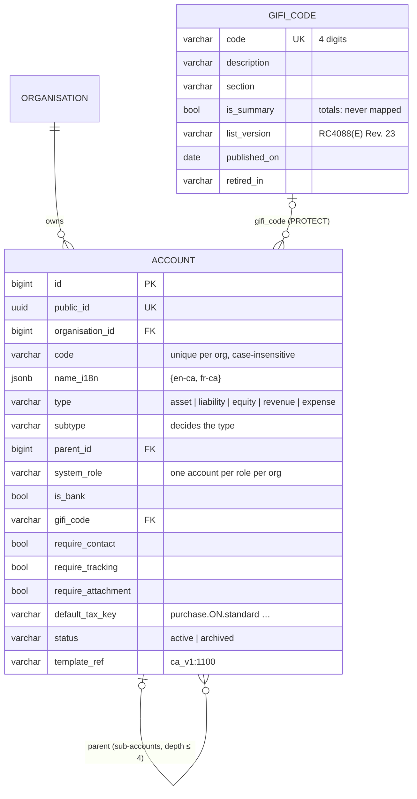

# Chart of accounts (C-01)

| | |
|---|---|
| **Deliverable** | C-01 · Chart of accounts, Phase 0 (component C — General Ledger) |
| **Code** | `backend/numo9/ledger/` (models, tree, guards, renumber, cache, gifi, template, contexts), `packages/ui/src/pickers/AccountPicker.tsx` (shared picker) |
| **Data** | `backend/numo9/ledger/data/coa_ca_v1.json` (Canadian template), `backend/numo9/ledger/data/gifi_rc4088_rev23.csv` (CRA GIFI list), `packages/ui/src/pickers/account-contexts.json` (picker contexts) |
| **Review file** | [`coa_template_ca_v1.xlsx`](../accounting/coa_template_ca_v1.xlsx) — the template for accountant sign-off (C-01-T01) |
| **Depends on** | A-01 (tenancy: `OrgOwnedModel`), A-04 (audit: `AuditedModel`, batches), A-10 (design system pickers) |
| **Used by** | C-02 posting engine (posts to leaf accounts by id), C-03 journals (require-contact/tracking/attachment flags), G-01 tax codes (tax-default keys, control accounts), G-07 GIFI export, B-01 contact defaults, F-01 bank accounts, every document line (account picker) |
| **Gaps** | gap-18, gap-29, gap-30, gap-44 (attribution), gap-45, gap-46; gap-07 groundwork (picker contexts) |

What Xero ships (xero_teardown §5.4–§5.5): 1500 Inventory typed Current asset (inventory blocked),
intangibles typed Fixed asset, one 820 "Sales Tax" control for GST/HST/PST/QST and ITCs, mixed
3- and 4-digit codes with system accounts that can't be renumbered, no sub-accounts, 0 of 139
accounts mapped to GIFI and every account defaulting to Tax Exempt. Numo9's chart fixes each of
these by design, below.

## Data model (C-01-T02, C-01-T04)

The field-by-field description is in the [data dictionary](../reference/data-dictionary.md#ledger-account).

### Types and sub-types

The sub-type decides the type ("type family"). The database refuses a sub-type outside its type
(`ledger_account_subtype_in_type`).

| Type | Sub-types | Normal side |
|---|---|---|
| Asset | Current asset · Bank · Inventory · Prepayment · Fixed asset · Accumulated amortization (contra) · Non-current asset · Intangible asset | Debit (accumulated amortization: credit) |
| Liability | Current liability · Sales tax control · Payroll liability · Non-current liability | Credit |
| Equity | Share capital · Retained earnings · Current year earnings · Dividends · Other equity | Credit |
| Revenue | Revenue · Other income | Credit |
| Expense | Cost of sales · Operating expense · Amortization · Income tax · Other expense | Debit |

Every Bank account is a bank account (`is_bank`); liabilities (credit card, line of credit, loan)
may also be bank accounts, so F-01 can link them to statement feeds. No other sub-type can.

### System roles (C-01-T06)

The posting engine finds the accounts it posts to by **role**, never by code: AR, AP,
GST/HST payable, ITC receivable, PST payable, QST payable, QST ITR, Retained earnings, Current
year earnings, Rounding, Conversion balances suspense, Unpaid expense claims, Wages payable, CPP,
QPP, EI and QPIP payable, Income tax withheld, Vacation pay payable, Workers' compensation
payable, Employer health tax payable, Inventory, Foreign exchange gain or loss.

| Rule | Where |
|---|---|
| One account per role per organisation | DB partial unique constraint `ledger_account_one_per_system_role` + `guards.check_system_role_rules` (error names the holder) |
| The role fits the sub-type (AR → Current asset, GST/HST payable → Sales tax control…) | `ROLE_SUBTYPES` |
| Role, type and sub-type never change once saved | guard on save |
| Can't be archived or deleted — soft, hard or in bulk; the error names the role | guard on save, `delete()`, `soft_delete()`, `QuerySet.delete()` |
| Code and name **may** change: system accounts renumber into the user's scheme (gap-29) | `renumber_account` |
| A system account is never a parent (it takes postings) | tree rules |

`QuerySet.update()` bypasses `save()` like for every model (A-04): only the renumber service uses
it, for the code alone.

## Sub-accounts (C-01-T03)

`numo9.ledger.tree` — checked on every save:

- the parent is in the same organisation; no account under itself or one of its sub-accounts;
- **same type family** — the child has the parent's type; a parent can't change type;
- **depth ≤ 4** — a moved account brings its sub-accounts, and the deepest must stay at level 4;
- **post-to-leaf** — only accounts without sub-accounts take postings: a parent is never a system
  account, an archived account, or an account that already has transactions.

`assert_postable(account)` (archived or has sub-accounts → `LedgerError`) is what C-02 and the
document validators call. "Has transactions" is asked through `numo9.ledger.postings`
(`register_posting_probe`): C-02 registers the journal-line probe; until then no account has any.

## Codes and renumbering (C-01-T07)

Codes are 1–10 letters, digits, `.` or `-`; unique per organisation without case
(`ledger_account_code_unique_per_org` on `lower(code)`). Everything refers to an account by id, so
**renumbering is a change of the code field only**: `renumber_account(account, "1105", actor=user)`
locks the row, refuses a code another account has (naming it, also under a concurrent rename),
writes one audit event `ledger.account.renumbered` with `{"code": [old, new]}` attributed to the
person, and busts the chart cache.

Lists, pickers and reports read the chart through `cache.chart_rows(organisation)` — the accounts in
chart order (type, code; sub-accounts under their parent with their depth and `postable`), cached
per organisation, chart version and language. Every account save or delete bumps the version (at
once and again on commit), so a renumbered code shows everywhere immediately.

## GIFI master list (C-01-T04)

`GifiCode` holds the CRA *General Index of Financial Information* — RC4088(E) Rev. 23, published
2023-08-23: 766 codes of the balance sheet (1000–3849), other comprehensive income (7000–7020) and
income statement (8000–9999, farming included), each with its section and an `is_summary` flag for
totals and computed lines (1599, 2599, 3499, 3620, 8299, 9367, 9999…). Identification lines
0001–0003 are not account codes and are left out. Seeded by migration `ledger/0002` and topped up
after every migrate (missing rows only). A later CRA list is a new data migration: new codes with
their version, dropped codes get `retired_in` (never deleted — accounts and past exports refer to
them).

An account's GIFI code must exist, must not be a total line, and must be in a section that fits
the account's type (an expense account can't map to 1001 Cash). `gifi.search(query, account_type=…)`
is the GIFI picker's search: by code prefix or words of the description.

## Canadian template (C-01-T01, C-01-T05)

`data/coa_ca_v1.json` — 118 rows, 4-digit codes (assets 1000–1999, liabilities 2000–2999, equity
3000–3999, revenue 4000–4999, cost of sales 5000–5999, expenses 6000–6999, income taxes 7000–7999),
every row GIFI-mapped. Corrections over the Xero chart:

| Xero | Numo9 template |
|---|---|
| 1500 Inventory typed Current asset | 1200 Inventory, sub-type **Inventory**, role Inventory (gap-18) |
| Goodwill, incorporation costs, licences, software, R&D typed Fixed asset | 1700–1751 sub-type **Intangible asset** with their accumulated amortization (gap-29) |
| One 820 Sales Tax control | **2100 GST/HST payable**, **1400 GST/HST receivable (ITCs)**, 2110 PST payable (BC/MB/SK), 2120 QST payable + 1410 QST ITRs (QC) (gap-29) |
| "Source deductions" | 2200 Wages, 2210 CPP, 2215 QPP (QC), 2220 EI, 2225 QPIP (QC), 2230 Income tax withheld, 2240 Vacation pay, 2250 Workers' compensation, 2260 Employer health tax (ON/BC/MB/NL/QC) |
| 3-digit system accounts sorting after 5950 | every account 4 digits; system accounts renumberable |
| 0 / 139 GIFI mapped | 118 / 118 mapped (gap-30) |
| Every account Tax Exempt | expense accounts default to the home-province purchase key (gap-45) |

`load_template(organisation, province, actor=user)` creates the chart for the **home province**:
rows limited to provinces load only there, and each tax kind becomes the province's key —
`purchase.<PROV>.standard`, `purchase.<PROV>.standard.itc50` (meals, 50 % ITC/ITR),
`sales.<PROV>.standard`, `purchase.exempt` / `sales.exempt` (bank charges, interest, insurance), or
none (balance sheet, wages, amortization). G-01 (Phase 1) resolves the keys to tax codes (ON →
"HST 13 % on purchases"). The load is one transaction and one audit batch; every account's
creation names the person loading it (gap-44); a chart with accounts is never loaded over.
`ensure_system_account(organisation, role, province=…)` adds a control account the chart lacks
(PST payable when an Ontario organisation registers for BC PST) at the template code or the next
free one. `template_ref` (`ca_v1:6040`) finds a template account after renumbering (P-01-T08 maps
Stripe fees to `ca_v1:6040`).

**Review (C-01-T01).** The accountant reviews [`coa_template_ca_v1.xlsx`](../accounting/coa_template_ca_v1.xlsx):
Template (every row with type, sub-type, role, GIFI code and description, tax key, provinces,
notes, reviewer comment, approved), Tax defaults per province, Checks (0 unmapped, 0 total lines,
4-digit codes, roles), Review questions, Sign-off (project lead + client accountant). The file is
generated from the JSON — changes go into the JSON, then
`python backend/tools/export_coa_template.py`; a test fails if the file is out of date.

## Account picker and contexts (C-01-T10)

`AccountPicker` in `@numo9/ui` is the one picker every screen uses: searchable by code or name,
grouped by type in chart order, sub-accounts indented under their parent; parents are shown but
can't be chosen (post-to-leaf); archived accounts are never offered (a current value stays
visible). `context` limits it to what the line may use — same rules on the server
(`numo9.ledger.contexts.allowed_in_context`, from the same JSON; a backend test fails if they
differ):

| Context | Offers | Never |
|---|---|---|
| `sales` | revenue, other income, current liabilities (deposits, deferred revenue) | expense accounts (gap-07), engine accounts, bank accounts |
| `purchase` | cost of sales, operating and other expenses; current, inventory, prepaid, fixed, non-current and intangible assets | revenue, engine accounts, bank accounts |
| `journal` | every postable sub-type | Current year earnings (computed) |
| `bank` | bank accounts (bank, credit card, line of credit, loan) | everything else, engine accounts |

Engine accounts are the system roles the engine posts to by itself (AR, AP, tax controls, payroll
liabilities, retained and current year earnings, rounding, suspense, FX).

## Errors

Every refusal is a `LedgerError` (a `ValidationError`) with a stable `code`, e.g.
`ledger.account.code_taken`, `ledger.account.system_archive`, `ledger.account.parent_type_mismatch`,
`ledger.account.too_deep`, `ledger.account.gifi_total`, `ledger.template.chart_not_empty`; the
message is translated and names the account or role concerned.

## Still to come

| Task | What |
|---|---|
| C-01-T08 | Archive service (balance must be 0, not system) — needs C-02 balances |
| C-01-T09 | API `/api/v1/orgs/{id}/accounts` (CRUD, tree, renumber, archive, bulk), feature key, sweep |
| C-01-T11 / T12 | Chart tree table and account drawer (GIFI picker, flags, tax default, balance) |
| C-01-T13 | Import/export via the B-03 framework |
| Phase 6 | French account names (`name_i18n["fr-ca"]`) and GIFI descriptions |

## Tests

| Task | Tests |
|---|---|
| T01 | `tests/test_coa_template_spreadsheet.py` |
| T02 | `tests/test_ledger_models.py` |
| T03 | `tests/test_ledger_tree.py` |
| T04 | `tests/test_ledger_gifi.py` |
| T05 | `tests/test_ledger_template.py` |
| T06 | `tests/test_ledger_guards.py` |
| T07 | `tests/test_ledger_renumber.py` |
| T10 | `packages/ui/src/pickers/AccountPicker.test.tsx`, story *Forms/Pickers › Account Picker Contexts*, `tests/test_ledger_contexts.py` |
| T14 | `tests/test_ledger_gaps.py` (+ `tests/fixtures/coa_ca_v1/expected.json`) |
