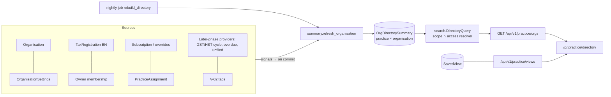

# Organisation directory (V-01)

The accountant's home: every organisation the practice serves, searchable, filterable, sortable,
with saved views. UX: [Organisation directory — UX research brief](../design/directory-ux-brief.md).
Code: `backend/numo9/workspace/` (API, search, summary) and `frontend/src/directory/` (screen).

## 1. The summary row (V-01-T02)

`OrgDirectorySummary` is a **derived read model**: one row per practice × organisation the practice
actively serves, with everything the directory searches, filters, sorts and counts. Nothing edits it
by hand.

| Column | Source |
|---|---|
| `name`, `legal_name`, `industry`, `province`, `fye_month`, `fye_day` | Organisation settings (A-05): display name (else the organisation's name), legal name, industry, physical province (else mailing), fiscal year end |
| `bn` | Registered BN (A-05 tax registrations), nine digits |
| `owner_name`, `owner_email` | The organisation's (earliest) owner membership |
| `package`, `status`, `trial_ends_at`, `payroll_enabled` | Entitlement engine (U-03): package code; organisation status mapped to *trial / paid / demo / read-only / archived* (active and grace → paid, cancelled → archived); a trialing subscription's period end; Payroll entitled |
| `gst_cycle`, `overdue_count`, `unfiled_count` | **Providers** registered by later phases (`summary.register_summary_provider`); empty / 0 until then |
| `tags` | The practice's tags (V-02 registers `summary.register_tags_provider` and calls `summary.tags_changed`) |
| `search_vector` | PostgreSQL `tsvector` (`simple` + `unaccent`): name, legal name, BN (weight A); owner name and email, tags (B); industry, province code and its English and French names (C) |

Indexes: GIN on `search_vector`, trigram (`gin_trgm_ops`) on `bn`, B-tree on (practice, name),
(practice, status) and organisation. The GIN/trigram indexes and the `unaccent`/`pg_trgm` extensions
are created on PostgreSQL only, so a throw-away SQLite database still migrates.

It is not an `OrgOwnedModel` (it is read across organisations, per practice): it is allow-listed in
`numo9.tenancy.checks.PLATFORM_MODELS`, and **every read goes through `search.directory_scope`**.

## 2. Keeping it current (V-01-T03)

- **Signals** (`workspace/signals.py`) on organisations, practice assignments, organisation settings,
  tax registrations, subscriptions, entitlement overrides, owner memberships and the owner's name or
  email schedule `summary.schedule_refresh(org)`: the organisation's rows are rebuilt **after the
  transaction commits**, once per organisation per transaction however many records changed. A
  change is visible as soon as its transaction commits (acceptance: < 5 s). A failing refresh is
  logged and never fails the user's save.
- **Nightly** `numo9.workspace.rebuild_directory` (beat 08:41 UTC) rebuilds every row and removes
  orphans, repairing any drift (a missed signal, a provider's late data). `manage.py
  rebuild_directory` does the same on demand (after an import or restore).
- An assignment switched off deletes its row; switched back on, the row returns.

## 3. Search, filters, facets (V-01-T04)

`search.directory_scope(user, practice)`: the practice's rows whose assignment is active, for a
practice-wide role (practice admin) all of them, otherwise only those where the user is assigned
staff (groups join with V-02) — **intersected with the access resolver** (A-01-T05), so an
organisation the user cannot open is never listed, matched or counted.

| Feature | Rule |
|---|---|
| Search `q` | Every word must match the start of a word (`maple sup`), accents and case ignored (`erable` → *Érable*); name, legal name, BN, owner, tags, industry, province (`quebec` → QC). A query of digits, spaces and dashes also matches the BN anywhere in its digits (`123 456` → `123456789`, trigram index). Results ranked (name/BN first) unless a sort is chosen |
| Filters | `package`, `status`, `province`, `fye` (month), `gst_cycle`, `payroll` / `overdue` / `unfiled` (`yes`/`no`), `tag`. Several values of one filter = any of them; several filters = all of them |
| Archived | Cancelled organisations are hidden unless `archived=include` or the status filter names `archived` |
| Facets | For each filter, each value's count **with every other filter applied**: choosing a value in a filter that had none selected narrows the list to exactly that count. Every status is always listed (zero counts dimmed); a chosen value stays listed even at 0 |
| Sort | Any column key, `-` for descending; empty text values sort last either way; ties by name |

Facets and counts are computed from **one slim read** of the searched rows (a practice's directory is
at most a few thousand small tuples), evaluated in Python with the same rules as the SQL filters;
the page itself is one ordered, sliced query. Three queries per request.

## 4. API (V-01-T05, T08)

`GET /api/v1/practice/orgs` — parameters and answer in the OpenAPI schema (`practice_orgs_list`):
`practice` (query or `X-Numo9-Practice`; may be omitted when the user has one practice), `q`, the
filters (repeatable), `archived`, `sort`, `page`, `page_size` (1–2,000), `columns`, `facets=0`.
The answer: `practice`, `count` (matching), `total` (in the directory), `page`, `page_size`, `pages`,
`columns`, `results` (`id` = organisation public id, `name`, plus the requested columns' fields,
including `package_name` and `trial_days_left`), `facets` (`value`, `label` in the request's
language, `count`).

| Situation | Answer |
|---|---|
| Not signed in | 401/403 |
| Unknown practice, not a member, no practice at all | 404 (the same answer) |
| Several practices and none named | 400 `workspace.practice_required` |
| Member without `practice.directory.view` | 403 `permission.denied` (every practice system role has it) |
| A refused parameter | 400 `workspace.bad_filter` / `bad_sort` / `bad_column` / `bad_page` with `field` |

Saved views — `GET/POST /api/v1/practice/views`, `PATCH/DELETE /api/v1/practice/views/<id>`: the
user's own named states (search and filters, shown columns in order, sort, density, opens by
default) per practice. Names unique per user and practice (case ignored), at most 50, one default.
Nobody else — not even the practice admin — lists, changes or deletes them (404). They live on the
server, so they follow the user after logout/login and on another device.

Neither endpoint is organisation-scoped (no `/o/<org>/` in the URL): both are on the tenant-sweep
exempt list (`^api/v1/practice/`), and `tests/test_workspace_isolation.py` (marker
`tenant_isolation`, run by the CI tenant-sweep job) sweeps random practice/staff/assignment graphs:
each user sees exactly their organisations, and searching the others' names or BNs finds nothing.

## 5. Performance (V-01-T06, T07)

- `manage.py seed_practice --orgs 2000 [--password …]` — a practice with 2,000 Canadian clients
  (valid BNs, provinces, fiscal year ends, owners, packages, statuses, staff with a share each);
  directory ready in about 40 s (acceptance < 2 min; `tests/test_workspace_seed.py` times it).
- `tools/perf/k6/directory-search.js` (`make perf-directory`) — 30 accountants with 0.5–2 s think
  time: first page with facets, word/accent/BN searches, filters, sorts, the full 2,000-row list and
  the go-to-organisation search; threshold p95 < 300 ms and no failures.

| Run (2,000 organisations, 2 vCPU, k6 on the same machine) | Directory p95 | Failures |
|---|---|---|
| 30 VUs, 0.5–2 s think time (acceptance scenario) | 164 ms | 0 |
| 1 VU, requests back to back (service time) | 92 ms | 0 |

Before the slim-read facets the same scenario measured p95 > 500 ms (12 queries per request).
`THINK=0` with many VUs is a saturation test of the machine, not of the directory. Rerun the
acceptance scenario on the staging server (ADR-0002) after each change to the directory queries.

## 6. The screen (V-01-T09…T15)

`/p/:practice/directory` (`frontend/src/directory/`), built from `@numo9/ui` only:

| Part | Behaviour |
|---|---|
| Grid (T09) | The shared `DataGrid` in **server mode** (`manual`): the server searches, filters and sorts; the grid virtualises up to 2,000 rows (only a screenful in the DOM), sticky header, status chips (*Trial 12 d*, Paid, Demo, Read-only, Archived), the organisation name links to its Home, an "Open in new tab" row action |
| Search (T10) | The grid's search box (`/` focuses it) asks the server **150 ms after the last key**; matches are highlighted with `<mark>` (`HighlightedText`: word starts, accents ignored; BN digits across spaces) |
| Filters (T11) | "Filters" (`F`) opens the panel: one `fieldset` per filter, each option with the server's facet count (zero options dimmed), "Show archived organisations"; active filters are removable chips |
| Columns and views (T12) | The shared `ColumnChooser` now also **reorders** (drag handle, or `Alt+↑/↓`, announced); the left rail lists the user's saved views (server-stored), "All organisations", "Save current view", and per view: Update with changes, Rename, Set as default, Delete (confirmed). The default view opens first |
| Keyboard (T13) | `/` search, `↓` from search into the rows, `↑/↓ PgUp/PgDn Home/End` move, `Enter` opens, `Ctrl/⌘+Enter` (or Ctrl/⌘+click) opens in a new tab, `F` filters. `Ctrl/⌘+K` anywhere opens **Go to organisation** (top bar slot, `GoToOrganisationSlot`): the same search, `↑/↓`, `Enter`, `Ctrl/⌘+Enter`, `Esc` |
| States (T14) | First run ("Create organisation" → creates a trial organisation for the practice via `POST /api/v1/organisations`; "Open demo" appears once U-07 provides the demo), no results ("Clear search and filters"), loading skeleton, error with Try again |
| i18n and a11y (T15) | Every string in `frontend/messages/*.json` (fr-CA placeholders until Phase 6); `role="grid"`, `aria-rowcount`, `aria-sort`, live result count, labelled regions; axe 0 serious/critical at 1280 and 360 px and in French |

Tests: `src/directory/*.test.tsx` and `packages/ui/src/data-grid/DataGridServer.test.tsx` (Vitest),
`e2e/directory.spec.ts` (Playwright: 2,000-row scroll ≈ 60 fps, BN typing, facet = result count,
saved view after logout/login, keyboard-only flow, axe; `@visual` snapshots of the five states).

## 7. Extension points for later deliverables

| Deliverable | Hook |
|---|---|
| V-02 groups and tags | `register_tags_provider`, `tags_changed(practice, orgs)`; group-based access in `directory_scope` (with the access resolver) |
| V-03 bulk actions | "Select all matching" sends the same query parameters (`api.parse_directory_params`) to the server |
| V-04 dashboards | Widgets return directory filter parameters for drill-down |
| G (GST/HST), D/E (invoices), K (filings) | `register_summary_provider` returning `gst_cycle`, `overdue_count`, `unfiled_count`, then `schedule_refresh(org)` on their own changes |

## Groups (V-02-T02)

`workspace.OrgGroup` — a practice's tree of groups of client organisations ("Toronto office →
Retail clients"), stored as a **materialised path** (`django-treebeard` `MP_Node`: `path`,
`depth`, `numchild`): a subtree or the ancestors are one indexed query, and a cycle can't be
represented. `workspace.OrgGroupMembership` files an organisation in a group (unique per group;
an organisation can be in several groups). Both are practice data (allow-listed in
`numo9.tenancy.checks`), never an organisation's records.

`numo9.workspace.groups` — `create_group(practice, name, parent=None)`, `rename_group`,
`move_group(group, parent | None)` (with its sub-groups), `add_organisation` /
`remove_organisation`, `groups_of(practice)` (tree order). Refusals are `GroupError` with a code:

| Code | Rule |
|---|---|
| `workspace.group.too_deep` | Depth 1–5: a sixth level, or a move that would put the moved subtree's deepest group at level 6. The database checks it too (`workspace_group_max_depth`) |
| `workspace.group.into_itself` | Not inside itself or one of its sub-groups |
| `workspace.group.other_practice` | Parent from the same practice only |
| `workspace.group.name_taken` | Unique among siblings, case and accents ignored (the same name under another parent is fine) |
| `workspace.group.name_required` / `name_long` | 1–80 characters |
| `workspace.group.not_served` | Only organisations the practice actively serves |

When a practice stops serving an organisation (assignment switched off or deleted) its
memberships in that practice's groups are removed; other practices' groups keep theirs.

## Tags (V-02-T03)

`workspace.Tag` — a practice's colour label for its client organisations ("Year-end soon"):
`name` (1–40 characters), `name_key` (the name without case, accents and repeated spaces —
**unique per practice**, database constraint `workspace_tag_name_unique_per_practice`), `colour`
from the 12-colour palette `TagColour` (red, orange, amber, olive, green, teal, cyan, blue, indigo,
violet, magenta, slate — each named; a tag always shows its name, never colour alone).
`workspace.OrgTag` puts a tag on an organisation (once). Practice data: another practice never
sees these tags, even on the same client.

`numo9.workspace.tags` — `create_tag`, `rename_tag`, `recolour_tag`, `tag_organisation`,
`untag_organisation`, `tags_of(practice, organisation)`; refusals `TagError`:
`workspace.tag.name_taken`, `name_required`, `name_long`, `colour`, `not_served` (only the
practice's clients). When a practice stops serving an organisation its tags on it are removed.

## Group staff (V-02-T04)

`workspace.GroupStaffAssignment` — a practice member assigned to a group with a role
(`GroupStaffRole`: accountant, reviewer, payroll specialist, read-only — practice admins see every
client already). **One row per group and member** (`workspace_group_staff_unique`): assigning again
changes the role. The member must belong to the group's practice
(`workspace.group.staff_other_practice`). Deleting a group removes its staff rows; a member who
still has group assignments can't be deleted (practice records are never cascade-deleted).
`numo9.workspace.groups.assign_staff(group, member, role)` / `unassign_staff(group, member)`.

The assignment grants access to every organisation of the group and of its sub-groups, including
organisations added later — the access resolver (V-02-T05) reads it; revocation applies on the
member's next request (V-02-T06).

## Access through groups (V-02-T05)

The A-01 resolver (`numo9.tenancy.access`) now grants an organisation to a user who is a member,
a practice admin of a practice actively serving it, its assigned staff — **or** assigned to a
practice group that holds it: the group itself **or any of its descendants** ("Toronto office"
covers "Toronto office → Retail clients"), as long as the group's practice still actively serves
the organisation. Organisations filed later are reachable at once.

The group part is an access source the workspace app registers
(`tenancy.access.register_access_source`), so `accessible_organisations` and `can_access` — every
organisation-scoped request and the organisation list — include it.
`numo9.workspace.access.group_organisation_ids(user)` is one query (materialised paths: "path
starts with an assigned group's path") **cached per user** (`access:groups:<user>:<generation>`).
The generation is bumped — at once and again at commit — on any save or delete of a group,
membership, group staff assignment, practice assignment or practice member, and after every group
move (paths change with raw SQL): a revocation applies on the next request (V-02-T06 adds the
integration tests per change).

`backend/tests/test_workspace_group_access.py` — Hypothesis: random trees (depth ≤ 5), filings,
group staff, direct staff, practice admins and assignments switched off; the resolver equals a
brute-force model of the rule for every user and organisation.

## Cache invalidation (V-02-T06)

Every way the access rows change bumps the generation, so a revocation applies on the member's
**next request** — in every web and worker process (the generation is in the shared cache):

| Change | How it is noticed |
|---|---|
| save / delete of a group, membership, group staff assignment, practice assignment or practice member (also cascades: deleting a group removes its sub-groups, memberships and staff) | `post_save` / `post_delete` |
| bulk `update()` / `bulk_create()` / `bulk_update()` of memberships and group staff | `workspace.models.AccessQuerySet` (their default manager) |
| bulk `update()` / `bulk_create()` / `bulk_update()` of practice members and practice assignments | `tenancy.models.AccessRowsQuerySet` sends `access_rows_changed` |
| group move (treebeard rewrites paths with raw SQL) | `groups.move_group` bumps |

The bump happens at once and again when the transaction commits, so a request that read the old
rows while the change was in flight can't keep them cached.

**Permissions follow the group role.** Access alone answers 403 on everything; the RBAC resolver
(A-03) also asks the registered *practice role sources* (`rbac.resolver.register_practice_role_
source`). The workspace source, `workspace.access.group_roles(user, organisation)`, names the role
of each group assignment that reaches the organisation (accountant, reviewer, payroll specialist,
read-only staff — the practice system roles of the same name): a member assigned to "Toronto
office" as *Read-only staff* reads those clients' books and changes nothing.

`backend/tests/test_workspace_group_access_invalidation.py` — warm cache, one change, the next
request answers 404: staff unassigned, organisation removed, membership deleted, group deleted
(cascade), sub-group moved out, practice stops serving (save and bulk update), bulk moves of staff
and memberships; grants (filing, bulk create) apply on the next request; access through a second
group or a direct assignment survives; another user's warm cache is refreshed too; the group role
decides read vs change.

## Groups and tags API (V-02-T07)

Under `/api/v1/practice/` (`numo9.workspace.groups_api`), practice-scoped like the directory:

| Endpoint | What |
|---|---|
| `GET groups?practice=…` | the tree in order: parent, depth, organisations filed directly, distinct organisations in the subtree, staff assigned directly |
| `POST groups` | create (`name`, optional `parent`) |
| `GET groups/<id>` | one group, its organisations and its staff — assigned here or *inherited* from an ancestor (`inherited_from`) |
| `PATCH groups/<id>` | rename (`name`) and/or move (`parent`: group id, `null` = top level) |
| `GET groups/<id>/impact` | what deleting it affects: groups, organisations, staff assignments, staff, and staff who would lose access to at least one organisation (other groups and direct assignments counted) |
| `DELETE groups/<id>` | delete with its sub-groups (organisations stay clients; access granted by its staff rows goes on the next request) |
| `POST groups/<id>/organisations` / `DELETE groups/<id>/organisations/<org>` | file organisations (`organisations`: up to 500 ids) / take one out |
| `PUT` / `DELETE groups/<id>/staff/<user>` | assign with a `role` (or change it) / unassign |
| `GET tags`, `POST tags`, `PATCH tags/<id>`, `DELETE tags/<id>` | the practice's tags (`colour_label` names the colour) |
| `POST tags/<id>/organisations` / `DELETE tags/<id>/organisations/<org>` | tag / untag |

Reading needs `practice.directory.view` (every practice role). **Every change needs
`practice.groups.manage`** — a practice permission only the Practice admin system role holds by
default (custom practice roles may be given it). Another practice's group, tag or client, or a
practice the user isn't a member of, answers 404. A group or tag rule refused answers 400 with the
service's code and the field (`workspace.group.too_deep`, `.name_taken`, `.into_itself`,
`workspace.tag.colour`…). `backend/tests/test_workspace_groups_api.py`.

The views are declared `AUTHENTICATED` (the practice comes from the query, body or object, not
from an active organisation) and name the practice permission they check with
`rbac.drf.checks_practice_permission(key)`; the permission matrix (A-03-T10) reads it and expects
`403 permission.denied` for every practice role without the key.

## Directory: group filter, group by, tags (V-02-T08)

`GET /api/v1/practice/orgs` gains:

- **`group`** filter (repeatable, any of them): a group's public id; an organisation filed in that
  group **or one of its sub-groups** matches. Its facet lists every group of the practice in tree
  order with `depth` (1 = top) and the count with the other filters applied. An id that isn't a
  UUID is a 400 (`field: "group"`); an unknown id matches nothing.
- **`groups`** column: the groups the organisation is filed in directly, `[{"id", "name"}]` — the
  badges of the row.
- **`group_by=group`** adds `grouping`: per group in tree order, `count` (matching organisations
  filed in it directly) and `organisations` (their ids, in the directory's order), then
  `group: null` for the organisations in no group. An organisation in two groups is under both.
- **Tags** reach the rows: the workspace registers its tags provider (`tags.provide_tags`) and
  every tag change (tag, untag, rename, delete) refreshes the affected rows, so the `tag` filter,
  its facet and the search see tag names.
- Staff assigned to a group see its organisations (and its sub-groups') in the directory, as they
  can open them (`search.group_scope`).

The screen (`frontend/src/directory`): a **Groups** filter in the panel (indented by level), a
**Groups** column with badges, and a **Group by** choice (*No grouping* / *Group*) that shows one
section per group — header "Toronto office — 12 organisations", collapsible — then *No group*
(`GroupedDirectory.tsx`). Tests: `backend/tests/test_workspace_directory_groups.py`,
`frontend/src/directory/DirectoryGroups.test.tsx`.

## Groups screen (V-02-T09…T11)

`/p/<practice>/groups` (`frontend/src/groups`, linked from the directory header as *Groups and
tags*):

- **Group tree** (`GroupTree.tsx`, V-02-T09) — an ARIA `tree` (`treeitem` with `aria-level`, one
  tab stop, ↑/↓/Home/End move the focus), each group with its organisations (sub-groups included)
  and staff counts and *Add sub-group*, *Rename*, *Move to…*. **Drag and drop**: drag a group onto
  another to move it under it, or onto the *Top level* zone that appears while dragging.
  **Keyboard alternative**: *Move to…* opens a dialog with the valid targets only (not the group,
  its sub-groups or its current parent; never deeper than 5 levels — `moveTargets`), chosen with
  the radio group and confirmed with *Move*. A refusal from the API (rule or permission) is shown
  as the server words it; a done move is announced (`role="status"`).
