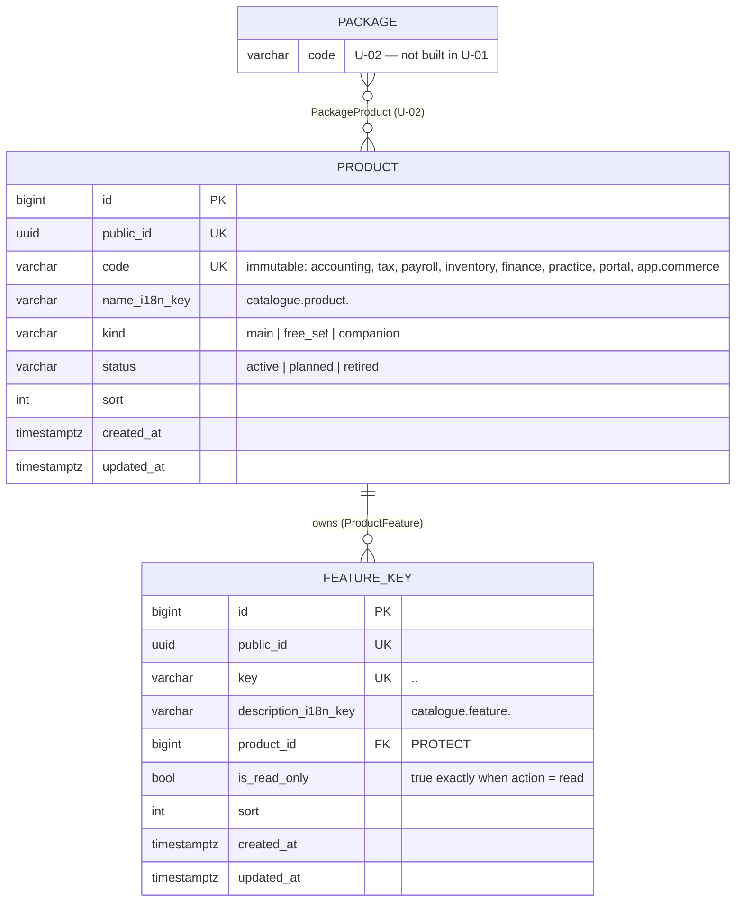

# Product catalogue and feature keys (U-01)

| | |
|---|---|
| **Deliverable** | U-01 · Product catalogue, Phase 0 |
| **Code** | `backend/numo9/catalogue/` (models, seed, decorator, API, exports), `packages/ui/src/entitlements/` (`useFeature`, `<Gated>`), `frontend/src/catalogue/` (screens) |
| **Depends on** | A-01 (tenancy), A-03 (permission catalogue pattern), A-04 (audit), S-01 (CI) |
| **Used by** | U-02 packages (packages are made of products), U-03 entitlement engine (organisation → products → feature keys), every gated endpoint and screen |

Numo9 is sold as packages (U-02) made of **products**. A product is a set of **feature keys**;
every gated API endpoint and every gated screen declares the one key it needs, and the
entitlement engine (U-03) answers "is this key in the organisation's package?". The catalogue is
**data** (rows in the database, seeded by migrations), so the Platform Owner sees one list, the
key → product → package matrix is exported and shown inside the app, and later phases add keys
with a data migration — never by changing code paths.

## Data model (U-01-T01)



| Entity | What it is | Rules |
|---|---|---|
| `Product` | something sold or given: a **main** product (Accounting, Tax, Payroll, Inventory, Finance [v2.1]), a **free set** (Practice, Portal — never billable) or a **companion** app Numo9 will build (Commerce, Bank, Receipts — `status=planned`) | `code` unique and **immutable** (feature keys start with it, packages and subscriptions refer to it); display name is an i18n key, so renaming a product changes text only, never a key; a `retired` product cannot be deleted (it stays for the history of the organisations that had it); a product with feature keys cannot be deleted at all (`PROTECT`) |
| `FeatureKey` | one gated capability: "create, edit and send invoices" | `key` unique (database unique index — the same key can never sit in two products); must start with its product's `code`; `is_read_only` is true exactly for `*.read` keys |
| `ProductFeature` | the product ↔ feature relation of the plan | implemented as the **`FeatureKey.product` foreign key**, not a join table: a join table would allow one key in two products, which the business rule forbids ("every feature key belongs to exactly one product") |
| `Package` / `PackageProduct` | U-02 — a package is a set of whole products | the matrix's package columns come from U-02; until it ships the catalogue answers with no packages (`numo9.catalogue.packages`, interface stub) |

Statuses: `active` — can be put in a package and sold (or given, for free sets); `planned` —
shown greyed with "Planned" (companion apps), never in a package; `retired` — no new packages,
existing subscribers keep it (U-02/U-03), never deleted.

## Feature-key naming convention

```
<product>.<area>.<action>
```

| Part | Rule | Examples |
|---|---|---|
| `<product>` | the owning product's `code` | `accounting`, `tax`, `practice`, `app.commerce` |
| `<area>` | one `snake_case` word group naming the screen family or document type (plural nouns) | `sales_invoices`, `chart_of_accounts`, `bills`, `returns` |
| `<action>` | exactly one of the three actions below | `read`, `write`, `approve` |

| Action | Grants | Notes |
|---|---|---|
| `read` | see the records and lists of the area, print and export them | `is_read_only = true`; **read keys survive a downgrade** for data created while the product was owned (U-03 rule) |
| `write` | create, edit, send, void, delete (soft) and import | implies nothing by itself: a write endpoint declares `write`, the list next to it declares `read` |
| `approve` | approve / post / authorise documents of the area | an approval belongs to its product: **inside the Accounting product nothing is gated by package** (approving invoices, credit notes, bank accounts, reminders, lock dates, audit — U-03 rule, gap-06). A key only says *which product* a control belongs to |

Rules that keep the key set small (risk: key sprawl):

1. One key per area and action; a new key only when a **different product** or a **different
   action** is involved. Sub-features of an area (attachments, PDF, e-mail) use the area's key.
2. A key is never renamed or moved to another product once released: endpoints, saved
   entitlements and the exported matrix refer to it. Retire the area instead and add a new key.
3. Every key has a plain-language description (`catalogue.feature.<key>`, EN + FR) written for an
   organisation owner: "Send invoice reminders before the due date", not "reminders.write".
4. Core platform controls are not features: sign-in, tenancy, users and roles, approval limits,
   audit log, background jobs and settings are part of every organisation and declare **`CORE`**
   (`"@core"`) instead of a key (see the developer guide).

Regular expressions (enforced on save and by the database seed tests):

| What | Pattern |
|---|---|
| product code | `^[a-z][a-z0-9_]*$` (main, free set) · `^app\.[a-z][a-z0-9_]*$` (companion) |
| feature key | `^<product code>\.[a-z][a-z0-9_]*\.(read\|write\|approve)$` |
| product name i18n key | `catalogue.product.<code>` |
| feature description i18n key | `catalogue.feature.<key>` |

## Seeded products (U-01-T04)

| Code | Kind | Status | Phase built |
|---|---|---|---|
| `accounting` | main | active | 0–1 (incl. projects, expenses and document capture — gap 51) |
| `tax` | main | active | 1 |
| `payroll` | main | active | 3 (keys added then) |
| `inventory` | main | active | 2 (keys added then) |
| `finance` | main | active | 2 — Finance [v2.1] (keys added then) |
| `practice` | free_set | active | 0 and 4 |
| `portal` | free_set | active | 4 |
| `app.commerce`, `app.bank`, `app.receipts` | companion | planned | 7–8 (W-02) |

The 7 products are the five main products and the two free sets; companion apps are extra rows
shown greyed. The Phase 0–1 feature keys (`accounting.*`, `tax.*`, `practice.*`, `portal.*`) are
seeded by migration `catalogue.0003_seed_catalogue` (59 keys); later phases add theirs the same
way. After every `migrate`/`flush` missing seed rows are re-created (rows the Platform Owner
changed are kept).

## Gating, APIs and tools (U-01-T05…T14)

| Piece | What |
|---|---|
| `@requires_feature` / `required_feature` / `CORE` | declaration on API views (`numo9.catalogue.drf`); `RequiresFeature` (default permission class) answers **402** `entitlement.feature_not_in_package` with `feature` and `product` when the resolver refuses — the plan's `feature_not_in_package`, as a dotted key like every other error code |
| Entitlement resolver | `settings.NUMO9_ENTITLEMENT_RESOLVER` — `AllowAllResolver` stub until U-03 |
| Package source | `settings.NUMO9_PACKAGE_SOURCE` — `NoPackages` stub until U-02 (packages) / U-03–U-04 (current package) |
| `manage.py check_feature_keys` | CI gate: business endpoints (`/api/v1/o/…`, `/api/v1/p/…`) declare a known key or `CORE` (`feature.E001`–`E003`) |
| `GET /api/v1/catalogue/products`, `/feature-matrix` | every signed-in user; public-safe fields; matrix lists every key once (key → product → packages) |
| `GET /api/v1/o/<org>/package-features` | the matrix plus the organisation's current package (`organisation.profile.view`, `CORE`) |
| `GET /api/v1/platform/catalogue/products`, `…/feature-matrix/export/<csv\|xlsx>` | platform console (`platform.catalogue.view`); exports recorded as `catalogue.matrix.exported`; also `manage.py featurematrix_export` |
| Audit | `Product` and `FeatureKey` are `AuditedModel`s: every change → `catalogue.product.*` / `catalogue.featurekey.*` with the field diff, in the platform log |
| Web app | `useFeature` / `<Gated>` (`@numo9/ui`, `@/catalogue/Gated`), route metadata `feature` (eslint `numo9/route-feature`), Products screen `/console/products`, Package and features `/o/:org/settings/package-features` |

Developer guide: [Feature keys](../dev/feature-keys.md).
