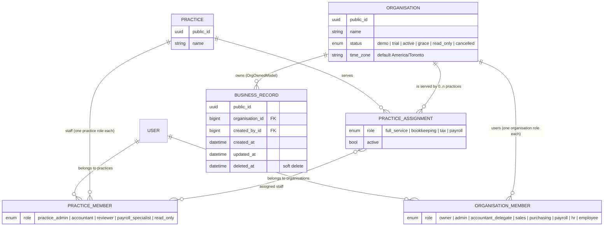
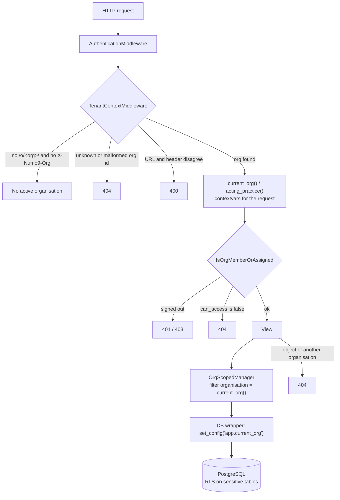

# Tenancy model

| | |
|---|---|
| **Deliverable** | A-01 · Practice & Organisation tenancy (Phase 0) |
| **Task** | A-01-T16 — this document |
| **Code** | `backend/numo9/tenancy/` |
| **Last updated** | 2026-11-09 |

Numo9 has **two tenant levels**. A **practice** is an accounting firm or a sole accountant and is
always free. An **organisation** is the paying business whose books live in Numo9. Every business
record belongs to exactly one organisation, and no user ever sees a record of an organisation they
cannot access.

## Data model

| Model | Kind | Key rules |
|---|---|---|
| `Practice`, `Organisation` | Platform | Public UUID used in URLs (`/o/<org public_id>/`); never cascade-deleted |
| `PracticeMember`, `OrganisationMember` | Platform | One row per user per tenant (unique); role must be in the system catalogue (database check) |
| `PracticeAssignment` | Platform | Unique per practice + organisation; `assigned_staff` must be members of that practice; `active` switches access off without losing history |
| Every business model | `OrgOwnedModel` | Organisation required; `created_by`; timestamps; soft delete (`soft_delete()` / `restore()`) |

Deleting a practice, organisation or user that still has memberships, assignments or records is
refused (`PROTECT`): records are kept for the CRA six-year period.

## Who can access an organisation

`can_access(user, org)` and `accessible_organisations(user)` (`access.py`) use one query, so the
organisation list and the access check never disagree. A user may access an organisation when the
user is **active** and either:

1. is a **member** of the organisation (any role), or
2. is a member of a practice **actively assigned** to the organisation **and**
   - holds a practice-wide role (`PRACTICE_WIDE_ROLES` = practice admin), or
   - is named in the assignment's **assigned staff**.

Nothing else grants access — not `is_superuser`, not `is_staff`. Platform staff reach
organisation data only through the admin (below) or audited impersonation (U-06). Access is never
cached: removing a membership, staff assignment or assignment takes effect on the next request.
Organisation-group assignment joins rule 2 with V-02-T04.

## Request flow

- **Active organisation** — from the URL (`/o/<org>/…`, `/api/v<n>/o/<org>/…`) or the
  `X-Numo9-Org` header (`middleware.py`).
- **Acting practice** — the `X-Numo9-Practice` header (must be actively assigned to the
  organisation), otherwise the single practice through which the user is assigned; none if there
  is no such practice or more than one.
- The context lives in `contextvars` (`context.py`) and is always cleared after the request.
  Background jobs set it with `org_context(org)` (A-01-T07).

## Org switcher (A-01-T14)

The web app's top bar shows the active organisation and, when the user acts through a practice,
the practice badge ("via Profitex"). The switcher panel lists the 5 organisations opened most
recently (kept in the browser), searches every organisation from `GET /api/v1/me/organisations`
(accent-insensitive, results capped at 20) and links to the practice directory
(`/p/<practice>/directory`, V-01). Choosing an organisation opens the **equivalent page**: the same
module (`/o/<a>/settings/lock-dates` → `/o/<b>/settings/lock-dates`); a record page lands on its
module, because the record belongs to the old organisation. The badge shows the first practice
returned by the API when the user is not a direct member. Opening an organisation also sets the
`numo9_org` cookie used by the redirect map (S-01-T14).

Code: `packages/ui/src/org-switcher/` (component, search), `frontend/src/components/OrgSwitcher.tsx`
(API, recent list, navigation), `frontend/src/routing/routes.ts` (`equivalentOrgUrl`).

## Isolation rules

| # | Rule | Enforced by |
|---|---|---|
| 1 | Every business model inherits `OrgOwnedModel`; only the six platform models are exempt | System check `tenancy.E001` (`checks.py`, `PLATFORM_MODELS`) |
| 2 | Every query is scoped to the active organisation; a query with no organisation raises `TenantContextMissing` | `OrgScopedManager` (`managers.py`) |
| 3 | `create()` uses the active organisation and refuses another one | `OrgScopedManager.create` |
| 4 | Crossing organisations needs `objects.unscoped(reason="…")`; every call is logged on `numo9.tenancy.unscoped` | `OrgScopedManager.unscoped` |
| 5 | An inaccessible organisation, an unknown one and another organisation's object all answer the **same 404** — never 403 | Middleware + `IsOrgMemberOrAssigned` (`permissions.py`) |
| 6 | Every organisation-scoped endpoint is swept as another organisation's user for GET/POST/PUT/PATCH/DELETE; endpoints without an organisation must be on `TENANT_SWEEP_EXEMPT` | `manage.py tenant_sweep` (`sweep.py`), CI job `tenant-sweep` |
| 7 | Sensitive tables have PostgreSQL row-level security; `app.current_org` is set per transaction | `EnableOrgRLS` migration operation + execute wrapper (`rls.py`) |
| 8 | Django admin only for active platform staff; business models read with logged `unscoped()`, delete is soft | `admin.py` (`OrgOwnedAdmin`) |

## Building on it — checklist for a new feature

- [ ] Business model inherits `OrgOwnedModel` (rule 1 fails `manage.py check` otherwise).
- [ ] Sensitive table (personal or financial data)? Add `EnableOrgRLS("<table>")` to its migration.
- [ ] Organisation-scoped endpoint lives under `api/v1/o/<uuid:org>/…` — the segment must be named
      `org` — and uses `IsOrgMemberOrAssigned`.
- [ ] Endpoint without an organisation? Add it to `TENANT_SWEEP_EXEMPT` with a comment saying why
      it returns no organisation's data.
- [ ] Never use `_base_manager` or raw SQL to reach other organisations; use `unscoped(reason=…)`.
- [ ] Register the model in the admin with `OrgOwnedAdmin`.
- [ ] `manage.py tenant_sweep` passes.

## Deployment requirements

- The application connects to PostgreSQL as an **ordinary role** — not a superuser and without
  `BYPASSRLS` — otherwise rule 7 is silently inactive (S-02-T04 / S-02-T06). Cross-organisation
  platform jobs that read RLS tables use a separate role with `BYPASSRLS`.
- `is_staff` is given only to Numo9 platform staff.

## Decisions taken in A-01

| Topic | Decision | Where |
|---|---|---|
| Organisation id in URLs | `public_id` (UUID), matching the frontend slug pattern | A-01-T03 |
| `PracticeAssignment.role` | What the practice does for the organisation (full service, bookkeeping, tax, payroll) | A-01-T01 |
| Practice-wide roles | Practice admin only; other practice roles need a staff assignment | A-01-T05 |
| Acting practice | Header `X-Numo9-Practice`, else the single assigned practice | A-01-T03 |
| Unsupported verb in the sweep | `405` accepted with `404` (reveals nothing) | A-01-T09 |
| OpenAPI schema | `/api/schema/`, signed-in users only | A-01-T13 |
| Organisation created without a practice | Creator becomes owner; with a practice, the creator is assigned staff | A-01-T13 |

## Code map

| File | Task |
|---|---|
| `models.py` — tenant models, `OrgOwnedModel` | T01, T02 |
| `context.py` — `current_org()`, `acting_practice()`, `org_context()` | T03 |
| `middleware.py` — `TenantContextMiddleware` | T03 |
| `managers.py` — `OrgScopedManager` | T04 |
| `access.py` — `can_access`, `accessible_organisations` | T05 |
| `permissions.py` — `IsOrgMemberOrAssigned` | T06 |
| `checks.py` — `tenancy.E001` | T08 |
| `sweep.py`, `management/commands/tenant_sweep.py` | T09 |
| `rls.py` — `EnableOrgRLS`, `app.current_org` wrapper | T12 |
| `api.py`, `serializers.py`, `urls.py` — `/api/v1/me/organisations`, practices, organisations | T13 |
| `admin.py` — admin scoping | T15 |
| `packages/ui/src/org-switcher/`, `frontend/src/components/OrgSwitcher.tsx` — org switcher | T14 |

Tests: `backend/tests/test_tenancy_*.py`, `test_tenant_*.py`, `test_org_*.py`,
`test_admin_scoping.py`; the isolation tests carry the `tenant_isolation` marker and run in the
CI `tenant-sweep` job.
