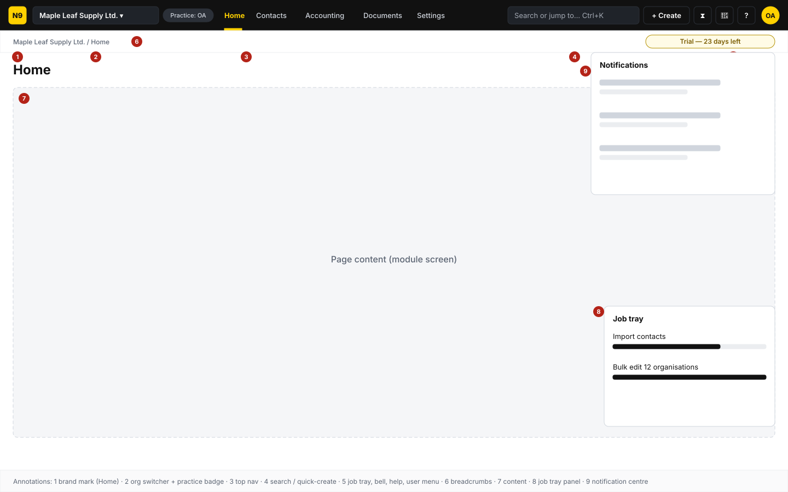
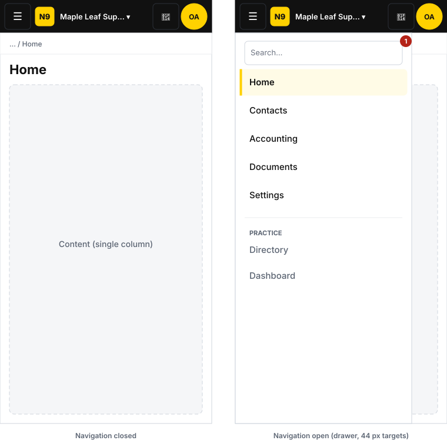
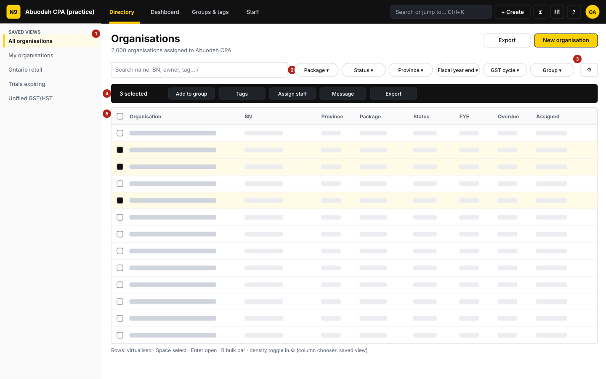
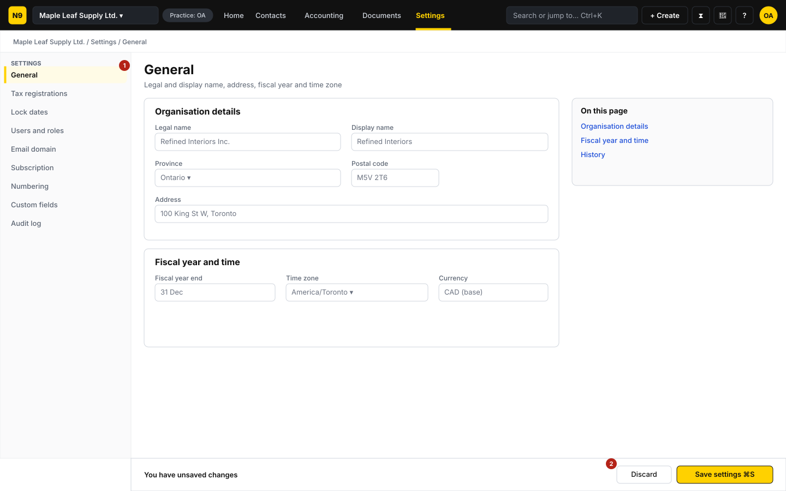
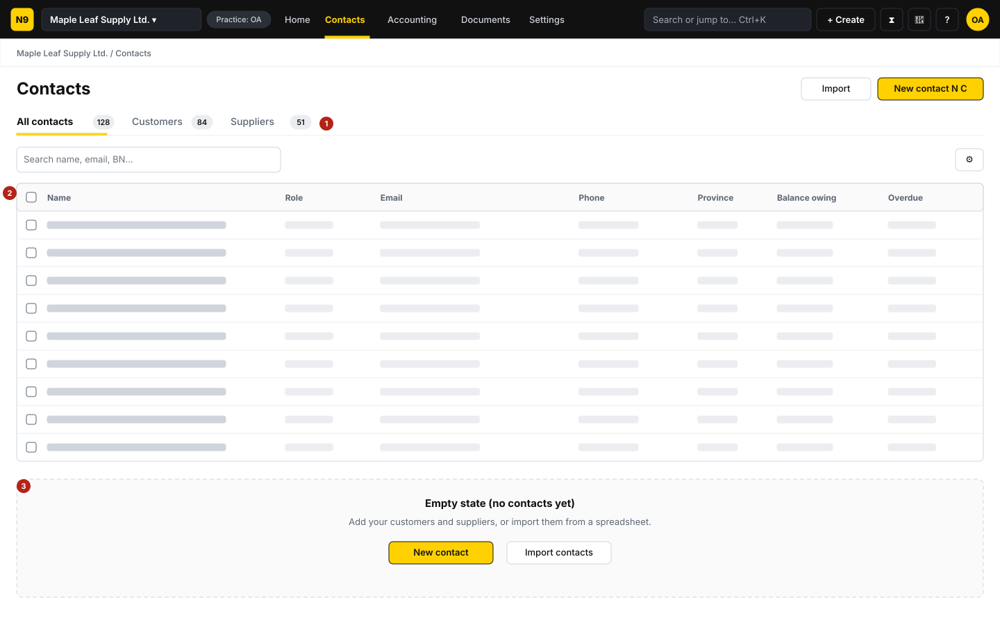
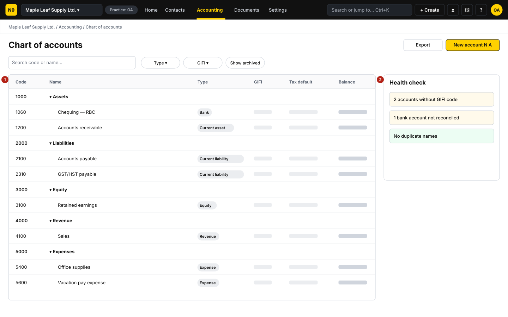
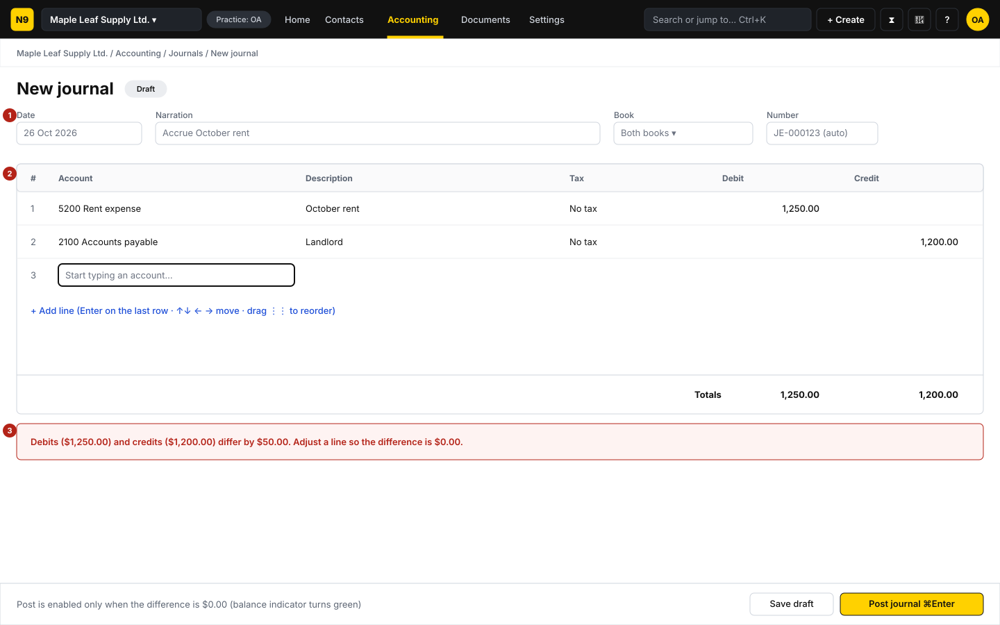
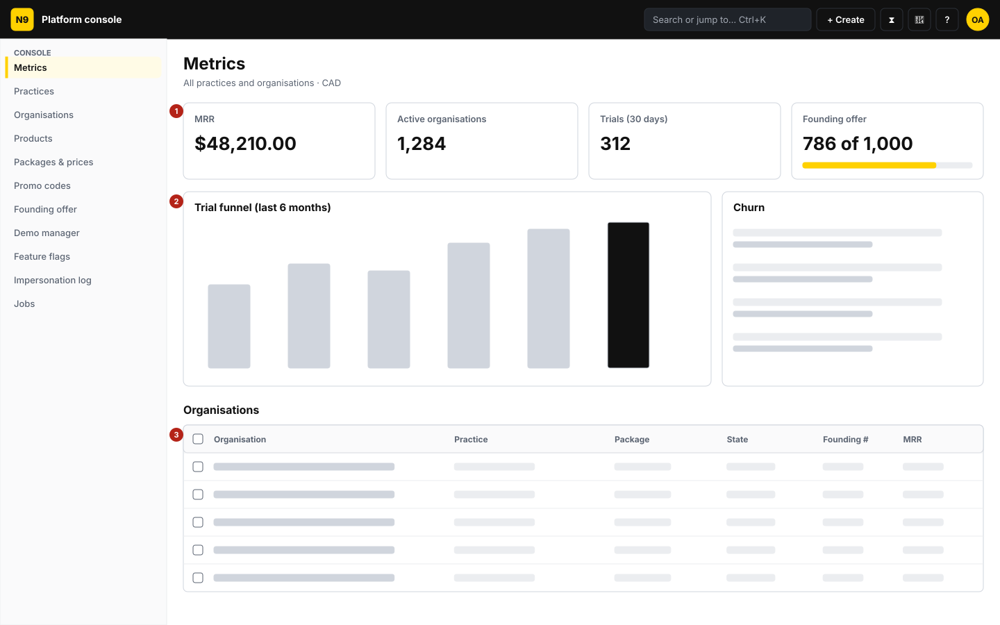

# Phase 0 wireframes

A-10-T02 · Deliverable A-10. Low-fidelity wireframes for the Phase 0 screens: the application shell,
the organisation directory, settings, contacts, chart of accounts, journal and the platform console.
They follow the information architecture and screen inventory of the Phase 0 plan (§3.2, §3.3) and
use the brand tokens from [Brand tokens](brand-tokens.md).

- Files: `docs/design/wireframes/*.svg` (1440 × 900 desktop frames; the shell also at 360 px).
  SVG imports into Figma as editable layers (drag the file onto the canvas), so the wireframes become
  the starting frames of the Figma file.
- Red numbered markers are annotations; the legend for each screen is below.
- Sample data is Canadian (Ontario organisation, CAD, GST/HST, Postal code `M5V 2T6`).
- Wireframes fix **layout, content and behaviour**, not final visuals. Components are the ones listed
  in A-10-T05 … T12; screens are built from `@numo9/ui` only.

## Walkthrough checklist (project lead)

| # | Screen | Built in | What to approve |
|---|---|---|---|
| 1 | Application shell (desktop, mobile) | A-10-T05 | Regions, nav order, org switcher position, job tray and notifications placement, mobile drawer |
| 2 | Organisation directory | V-01 / A-10-T10 | Saved views rail, search + filter chips, bulk bar, grid columns |
| 3 | Settings (General) | A-05 | Settings left nav with deep links, sectioned form, sticky save bar |
| 4 | Contacts list | B-01 | Role tabs with counts, grid columns, empty state |
| 5 | Chart of accounts | C-01 | Tree grid, type badges, GIFI column, health-check panel |
| 6 | Journal (basic) | C-02 / A-10-T11 | Header fields, LineGrid, totals, unbalanced message, post shortcut |
| 7 | Platform console | U-06 | Console nav, KPI tiles incl. founding counter, organisations grid |

## 1. Application shell

| Marker | Region | Behaviour |
|---|---|---|
| 1 | Brand mark | Links to the current organisation's Home (or the practice directory in `/p/…`) |
| 2 | Org switcher + practice badge | Shows the active organisation; menu lists the 5 recent organisations, a search box and "Open directory" (A-01-T14). The badge names the acting practice |
| 3 | Top navigation | Task-first modules that exist in Phase 0: Home · Contacts · Accounting · Documents · Settings. Active item: yellow text and underline on black. Later phases add Sales, Purchases, Banking, Tax, Payroll, Inventory, Reports |
| 4 | Search / quick-create | Command palette `Ctrl/⌘+K` (A-09); "+ Create" opens quick-create with shortcuts (`N I`, `N C`, `N J` …) |
| 5 | Job tray · notifications · help · user menu | Job tray icon (background jobs), bell (`Shift+N`), help/shortcuts (`?`), avatar menu (Profile, Preferences, Log out) |
| 6 | Breadcrumbs | Organisation › module › page; every crumb is a link; trial chip ("Trial — 23 days left") sits at the end of this bar |
| 7 | Content | Module screen; no promotional banners inside working screens (gap 12) |
| 8 | Job tray panel | Running and recent jobs with progress |
| 9 | Notification centre | Drawer, grouped by day, mark as read |

Below 1024 px the top navigation collapses into a menu button (44 × 44 px) that opens a drawer with
search, the module list and the practice links; the org switcher truncates the name; the bell and
user menu stay visible. No horizontal scroll at 360 px.

## 2. Organisation directory (practice workspace)

| Marker | Region | Behaviour |
|---|---|---|
| 1 | Saved views rail | Personal and shared views; selected view highlighted |
| 2 | Search + filter chips | Search name, BN, owner, tag (`/` focuses); chips: Package, Status, Province, Fiscal year end, GST cycle, Group |
| 3 | Grid settings | Column chooser, density (comfortable/compact), save view |
| 4 | Bulk bar | Appears when rows are selected: Add to group, Tags, Assign staff, Message, Export |
| 5 | DataGrid | Virtualised; columns Organisation, BN, Province, Package, Status, FYE, Overdue, Assigned; `Space` select, `Enter` open, `B` bulk bar |

States: first-run empty state ("Create your first organisation" + "Open a demo"), no results, loading
skeleton, error with retry.

## 3. Settings — General

| Marker | Region | Behaviour |
|---|---|---|
| 1 | Settings navigation | Deep links `/o/:org/settings/{general, registrations, lock-dates, users-roles, email-domain, subscription, numbering, custom-fields, audit-log}`; each module's gear links its own section (gap 3) |
| 2 | Sticky save bar | Appears on first change: "You have unsaved changes", Discard, Save settings (`⌘S`); leaving with unsaved changes asks first |

Form uses Province picker and Postal code input; "On this page" anchors on wide screens.

## 4. Contacts

| Marker | Region | Behaviour |
|---|---|---|
| 1 | Role tabs | All contacts / Customers / Suppliers with counts; the page title follows the tab (gap 19) |
| 2 | DataGrid | Name, Role, Email, Phone, Province, Balance owing, Overdue |
| 3 | Empty state | Explains the next step with two actions: New contact, Import contacts |

## 5. Chart of accounts

| Marker | Region | Behaviour |
|---|---|---|
| 1 | Tree grid | Headers (Assets, Liabilities, Equity, Revenue, Expenses) collapse; columns Code, Name, Type badge, GIFI, Tax default, Balance; archived toggle |
| 2 | Health check | Accounts without a GIFI code, unreconciled bank accounts, duplicates |

`N A` creates an account.

## 6. Journal (basic, C-02 test path)

| Marker | Region | Behaviour |
|---|---|---|
| 1 | Header | Date (forgiving input, displayed `26 Oct 2026`), Narration, Book (Both / Tax / Management), Number (auto) |
| 2 | LineGrid | The shared document line editor (A-10-T11): account picker, description, tax, debit, credit; arrows move, `Enter` on the last row adds a line, drag to reorder |
| 3 | Balance message | Names both totals and the difference (§3.5 microcopy); Post is disabled until the difference is $0.00 |

`⌘Enter` posts; the posted journal gets its number and a "Reverse" action.

## 7. Platform console

| Marker | Region | Behaviour |
|---|---|---|
| 1 | KPI tiles | MRR, active organisations, trials, founding offer counter ("786 of 1,000") |
| 2 | Charts | Trial funnel and churn; empty data renders as 0, never "—k" |
| 3 | Organisations grid | Organisation, Practice, Package, State, Founding #, MRR |

Console navigation: Metrics, Practices, Organisations, Products, Packages & prices, Promo codes,
Founding offer, Demo manager, Feature flags, Impersonation log, Jobs.
