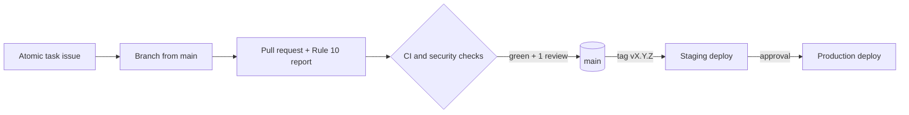

# Numo9 documentation

**Numo9** — "Numbers build a brighter tomorrow". A Canadian, package-based accounting and practice
SaaS built by Gray Matter AI for Profitex.

| Start here | What it covers |
|---|---|
| [Contributing](contributing.md) | Local setup, the engineering workflow, branches, commits, pull requests |
| [Branch policy](branching.md) | Protected `main`, branch naming, release tags, Dependabot exception |
| [Architecture decisions](adr/index.md) | Why the system is built the way it is (ADRs) |
| [Data-residency register](security/data-residency-register.md) | Where every data class lives and every sub-processor (ADR-0002) |
| [Project plan](Numo9_Project_Plan.md) | Scope, components, acceptance and the gap analysis against Xero |
| [Phase plans](phase_plans/Phase_0_Foundation_and_SaaS_Core.md) | Deliverables and atomic tasks, phase by phase |

## Repository layout

```text
backend/    Django 5.2 API and workers
frontend/   Next.js 15 web app (App Router, TypeScript strict)
mobile/     Expo workspace (Phase 7)
infra/      deploy scripts, staging stack
docs/       this site (MkDocs Material)
tools/      repository tooling (CI, pre-commit helpers)
```

## Delivery flow


