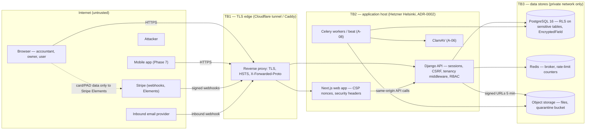

# Threat model (STRIDE)

| | |
|---|---|
| **Deliverable** | S-03 · Security baseline (Phase 0) |
| **Task** | S-03-T11 — this document |
| **Scope** | Tenancy, authentication, billing, files — the four areas every later module builds on |
| **Method** | STRIDE per element of the data-flow diagram; each threat → mitigation → owning task → status |
| **Last updated** | 2026-11-10 |
| **Review cadence** | Before each phase exit, and whenever a deliverable adds a trust boundary (new external service, new public endpoint, new file type, new payment flow) |

Status legend: **In place** = implemented and covered by a test in `main` · **Planned** = owned by
the named atomic task in `docs/phase_plans` (not yet built) · **Accepted** = residual risk accepted
with the reason given.

## 1. System overview and trust boundaries

| Boundary | Crossing | Rule |
|---|---|---|
| TB1 Internet → edge | every request | TLS only; HSTS 1 y preload; the app is reachable only through the proxy (ports bound to 127.0.0.1) |
| TB2 edge → app | proxied requests | proxy sets `X-Forwarded-Proto`; Django trusts only that header (S-03-T01) |
| TB2 app → browser | every response | CSP with nonces, Stripe the only third party (S-03-T02); full security-header set (S-03-T10) |
| TB3 app → data | queries, objects | per-request organisation context; scoped managers; RLS as second line (A-01) |
| Stripe ↔ Numo9 | webhooks, Elements | raw card/bank data never touches Numo9 (PCI out of scope); webhooks verified by signature (U-04) |

## 2. Assets

| Asset | Why it matters | Where |
|---|---|---|
| Organisation books (ledger, invoices, bills, contacts) | Core client data; cross-tenant leak is the worst-case incident | PostgreSQL, org-scoped models |
| Personal data: SIN, bank accounts, payroll, contact details | PIPEDA; identity theft | `EncryptedField` (S-03-T04), masked in UI (S-03-T05), scrubbed from logs (S-03-T06) |
| Credentials: passwords, TOTP secrets, recovery codes, sessions, invitation and reset tokens | Account takeover | Argon2id hashes, hashed tokens (A-02) |
| Subscription and entitlement state | Revenue; feature leakage | U-03/U-04 |
| Uploaded files and inbound email | Malware entry point; confidential documents | Object storage (A-06) |
| Secrets and keys: `SECRET_KEY`, field-encryption KEKs, Stripe keys, deploy keys | Total compromise | SOPS + age, GitHub Environments (S-03-T03) |
| Audit log | Non-repudiation, CRA retention | Append-only table (A-04) |

## 3. Actors

| Actor | Trust | Notes |
|---|---|---|
| Anonymous visitor | none | sign-up, login, reset, invitation links, CSP report endpoint |
| Organisation user (any role) | own organisation, limited by role and package | A-03 roles, U-03 entitlements |
| Practice member | assigned organisations only | access fans out over `PracticeAssignment`; revocation on next request |
| Platform owner (Profitex) | platform | console, impersonation with consent and audit (U-06); 2FA mandatory (A-02-T06) |
| Malicious insider (removed staff) | formerly trusted | no cached access; session revoke (A-02-T07) |
| External attacker | none | credential stuffing, injection, XSS, CSRF, SSRF, malware uploads, webhook forgery |
| Stripe / email provider | integration | authenticated by signature/secret, never by source IP alone |

## 4. Tenancy (A-01)

| ID | STRIDE | Threat | Mitigation | Owner task | Status |
|---|---|---|---|---|---|
| TEN-01 | Information disclosure | A user reads another organisation's records by changing the org slug, header or an object id (IDOR) | Middleware resolves the active org; `OrgScopedManager` filters every query and raises without context; object permission returns **404** for foreign objects | A-01-T03, T04, T06 | In place |
| TEN-02 | Information disclosure | A new endpoint forgets the scope | Router sweep `manage.py tenant_sweep` requests every URL as another org's user (CI `tenant-sweep`); system check: every business model inherits `OrgOwnedModel` | A-01-T08, T09 | In place |
| TEN-03 | Information disclosure | A raw SQL/ORM bypass (`unscoped()`, `.raw()`) leaks rows | `unscoped()` is explicit and logged; PostgreSQL RLS on the five most sensitive tables with `app.current_org` set per transaction | A-01-T04, T12 | In place |
| TEN-04 | Elevation of privilege | A practice member removed from an organisation keeps access through a cache | Access resolved on every request, no caching; revocation test | A-01-T05, T10 | In place |
| TEN-05 | Elevation of privilege | Practice-wide role used on an organisation not assigned to the practice | `can_access` = org member OR member of an *assigned* practice with practice-wide role / assigned staff; property test over random graphs | A-01-T05, T11 | In place |
| TEN-06 | Tampering | Background job runs without org context and writes into the wrong organisation | Celery base task requires explicit `org_id` and sets the context | A-01-T07 | Planned |
| TEN-07 | Spoofing | Platform staff use Django admin to browse tenant data unaudited | Admin restricted to platform staff; org-scoped admin views use explicit `unscoped` with audit | A-01-T15 | In place |
| TEN-08 | Repudiation | Impersonation by the platform owner is denied later | Time-boxed impersonation with consent, actor/impersonator recorded on every audit event | U-06, A-04-T01 | Planned |
| TEN-09 | Information disclosure | Demo/trial data appears in platform metrics or another tenant's search | Demo organisations flagged (`status=demo`), excluded from metrics; search indexes scoped by org | U-07, A-09 | Planned |
| TEN-10 | Denial of service | One organisation's heavy imports or reports starve others | Per-org rate limits and queue separation | S-06, A-08-T01 | Planned |

## 5. Authentication and sessions (A-02)

| ID | STRIDE | Threat | Mitigation | Owner task | Status |
|---|---|---|---|---|---|
| AUTH-01 | Spoofing | Credential stuffing / password spraying | Login rate limit per IP and per account (429 + `Retry-After`); lockout 15 min after 10 failures; CAPTCHA hook after repeated failures | A-02-T03, S-03-T07 | In place |
| AUTH-02 | Spoofing | Weak or breached passwords | ≥ 12 characters, Django validators, breached-password check (HIBP k-anonymity, only a 5-character SHA-1 prefix leaves the server); Argon2id hashing | A-02-T02 | In place |
| AUTH-03 | Spoofing | Account created with someone else's email | Email verification required before the first login | A-02-T02 | In place |
| AUTH-04 | Spoofing | Stolen password used without second factor | TOTP 2FA (±1 step), 10 single-use hashed recovery codes; mandatory for platform owner and, when enabled, practice admins; remember-device cookie signed and bound to the user, 30 days | A-02-T05, T06 | In place (TOTP, recovery codes, trusted device) / Planned (enforcement, A-02-T06) |
| AUTH-05 | Tampering | Password-reset token reused, guessed or leaked via Referer | Token valid 1 h, single use (bound to password hash), all sessions invalidated on reset; `Referrer-Policy: strict-origin-when-cross-origin` | A-02-T04, S-03-T10 | In place |
| AUTH-06 | Information disclosure | Account enumeration through login, sign-up or reset responses | Same response for unknown email and wrong password; reset always answers "if an account exists"; sign-up of an existing email sends a notice instead of an error | A-02-T02–T04, T09 | In place |
| AUTH-07 | Spoofing | Session hijacking (XSS, network) | HttpOnly + Secure + SameSite=Lax cookies; HSTS; nonce CSP; session id rotated at login; session registry with revoke | S-03-T01, T02, A-02-T07 | In place (cookies, CSP) / Planned (registry) |
| AUTH-08 | Tampering | CSRF on state-changing API calls | Django CSRF with HttpOnly cookie + token from `GET /api/v1/auth/csrf`; `CSRF_TRUSTED_ORIGINS`; SameSite=Lax | S-03-T01 | In place |
| AUTH-09 | Elevation of privilege | Invitation link used by someone else or twice | Token stored as a hash, single use, 7-day expiry, accept bound to the invited email; wrong-account prompt | A-02-T08, T09, T12 | In place (model, service, API) / Planned (accept screen, A-02-T12) |
| AUTH-10 | Repudiation | User denies a login, 2FA change or invite | Audit events for login success/fail, 2FA changes, invitation events | A-02-T14 | Planned |
| AUTH-11 | Denial of service | Attacker locks a victim out by failing their logins on purpose | Lockout is per account *and* short (15 min); successful 2FA/recovery path and reset still work; IP limit stops a single source first | S-03-T07 | In place — Accepted residual: a distributed attacker can keep an account locked; monitored via audit |
| AUTH-12 | Information disclosure | Passwords, tokens or SIN in logs and error reports | Log scrubbing by key and by shape; Sentry `before_send` scrubbing, no PII | S-03-T06 | In place |

## 6. Billing and payments (U-01 … U-08, P-01 … P-05)

| ID | STRIDE | Threat | Mitigation | Owner task | Status |
|---|---|---|---|---|---|
| BIL-01 | Information disclosure | Card or bank data captured by Numo9 (PCI scope) | Stripe Elements/Checkout only; card/PAD details go browser → Stripe; Numo9 stores Stripe ids only; CSP allows only Stripe as third party | U-04, S-03-T02 | Planned (U-04) / CSP in place |
| BIL-02 | Spoofing | Forged Stripe webhook marks a subscription paid | Verify `Stripe-Signature` with the endpoint secret and timestamp tolerance; reject unsigned; secrets in SOPS | U-04 | Planned |
| BIL-03 | Tampering | Webhook replay or duplicate delivery creates duplicate subscriptions/invoices | Idempotency on Stripe event id (unique constraint) and on job idempotency keys | U-04, A-08-T02 | Planned |
| BIL-04 | Elevation of privilege | Lapsed or downgraded organisation keeps paid features (entitlement leak) | Entitlement engine checked on every gated endpoint → HTTP 402 with required product; cache invalidated on subscription change; downgrade removes write at once | U-03 | Planned |
| BIL-05 | Tampering | Client manipulates price, package or promo code in the request | Prices and packages server-side only (Stripe price ids from the catalogue); promo codes validated server-side, single redemption rules | U-02, U-04 | Planned |
| BIL-06 | Tampering | Founding-offer counter over-allocated under concurrency | Atomic increment on first successful payment, race test with 1,500 concurrent payments | U-08 | Planned |
| BIL-07 | Spoofing | Trial abuse: repeated trials with new emails | One trial per BN / email; trial state server-side | U-05 | Planned |
| BIL-08 | Elevation of privilege | Organisation user (non-owner) changes the subscription | Subscription actions require owner/admin permission (RBAC) | A-03, U-04 | Planned |
| BIL-09 | Repudiation | Owner disputes a plan change or cancellation | Audit events on subscription changes; Stripe invoices as second record | A-04, U-04 | Planned |
| BIL-10 | Denial of service | Failed renewal locks an organisation out of its data | Grace then read-only (never deleted); data export on cancellation | U-04 | Planned |

## 7. Files and documents inbox (A-06)

| ID | STRIDE | Threat | Mitigation | Owner task | Status |
|---|---|---|---|---|---|
| FIL-01 | Tampering | Malware uploaded and later opened by an accountant | ClamAV scan before a file is usable; infected files to a quarantine bucket; status `scanning/infected/ready` | A-06 | Planned |
| FIL-02 | Spoofing | File type spoofing (`.pdf` that is HTML/JS) → stored XSS | MIME sniffed with libmagic, allow-list of types; downloads served as attachments from the storage domain with `nosniff`; app origin's CSP forbids inline script | A-06, S-03-T02, S-03-T10 | Planned / headers in place |
| FIL-03 | Information disclosure | Object URL guessed or shared outside the organisation | Private bucket; signed URLs valid 5 minutes, generated only after the org-access check; random object keys | A-06 | Planned |
| FIL-04 | Information disclosure | Inbound email delivered into the wrong organisation | Per-organisation random inbox token (`docs+<token>@in…`); provider webhook authenticated; unknown token rejected | A-06 | Planned |
| FIL-05 | Denial of service | Oversized files, zip bombs, PDFs with huge page counts | 25 MB per-file limit, page count via pypdf only, decompression limits, quotas per org | A-06 | Planned |
| FIL-06 | Elevation of privilege | Path traversal in file names or SSRF through "import from URL" | Storage keys generated server-side, original name kept as metadata only; no server-side URL fetching in Phase 0 | A-06 | Planned |
| FIL-07 | Information disclosure | Files kept after deletion against retention rules, or deleted before CRA's 6 years | Soft delete; lifecycle rules per data class (data-residency register) | A-06, S-02-T09 | Planned |
| FIL-08 | Repudiation | Uploader denies having uploaded/removed a document | Audit events for upload, download (signed URL issuance), delete | A-04, A-06 | Planned |

## 8. Cross-cutting threats

| ID | STRIDE | Threat | Mitigation | Owner task | Status |
|---|---|---|---|---|---|
| X-01 | Tampering | Vulnerable dependency or base image | pip-audit, pnpm audit, Trivy gating with justified, expiring allow-list; Dependabot weekly | S-03-T09, S-01-T16 | In place |
| X-02 | Information disclosure | Secret committed to Git | gitleaks (history + pre-commit), `check_secrets.py`, SOPS + age | S-03-T03 | In place |
| X-03 | Information disclosure | Sensitive field readable by a DB dump or backup | `EncryptedField` (AES-256-GCM envelope, key id with ciphertext, rotation) | S-03-T04 | In place |
| X-04 | Tampering | Clickjacking, MIME sniffing, mixed content | `frame-ancestors 'none'` + `X-Frame-Options: DENY`, `nosniff`, HSTS | S-03-T01, T02, T10 | In place |
| X-05 | Tampering | Audit log altered by ORM `update()` or a DBA | DB trigger + REVOKE UPDATE/DELETE, hash chain with `audit_verify` | A-04-T01, T02 | Planned |
| X-06 | Elevation of privilege | Endpoint without a declared permission | `required_permission` per method, CI check failing undeclared endpoints | A-03-T05, T06 | Planned |
| X-07 | Spoofing | Unknown issue reported nowhere | `security.txt` and disclosure policy | S-03-T12 | Planned |
| X-08 | Tampering | Web-app vulnerabilities in staging not caught by unit tests | OWASP ZAP baseline nightly + pre-release, 0 high | S-03-T08 | Planned |

## 9. Residual risks and decisions

| Risk | Decision |
|---|---|
| Distributed lock-out of a known account (AUTH-11) | Accepted: lockout is short, reset and recovery paths stay open, failures are audited and alertable (S-04 in Phase 5). |
| Breached-password API unavailable | Accepted: the validator fails open (logs a warning) so sign-up is not blocked by a third party; length and common-password validators still apply. |
| Django admin and DRF browsable API allow inline scripts (no script restriction in their CSP) | Accepted: reachable by platform staff only (admin) or in dev only (browsable API); framing, plugins, `<base>` and foreign form targets are still blocked. |
| `--ignore-unfixed` in Trivy | Accepted: OS CVEs without a published fix cannot be remediated; they are re-evaluated on every weekly run once a fix appears. |

## 10. Review log

| Date | Reviewer | Scope | Outcome |
|---|---|---|---|
| 2026-11-10 | Engineering (GMA) | Initial model: tenancy, auth, billing, files, cross-cutting; mitigations cross-checked against the code in `main` and the Phase 0 cards | Complete; planned controls mapped to their atomic tasks |
| — | Project lead | Sign-off | Pending — record the date here after the review meeting |
